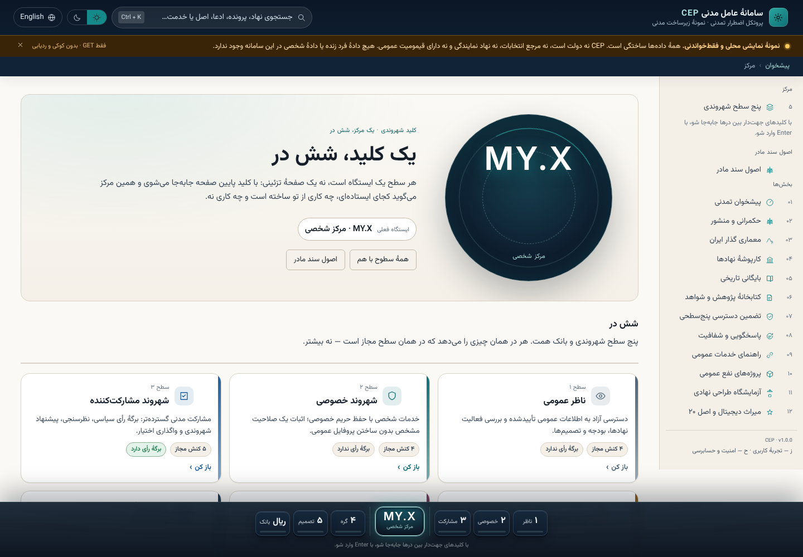
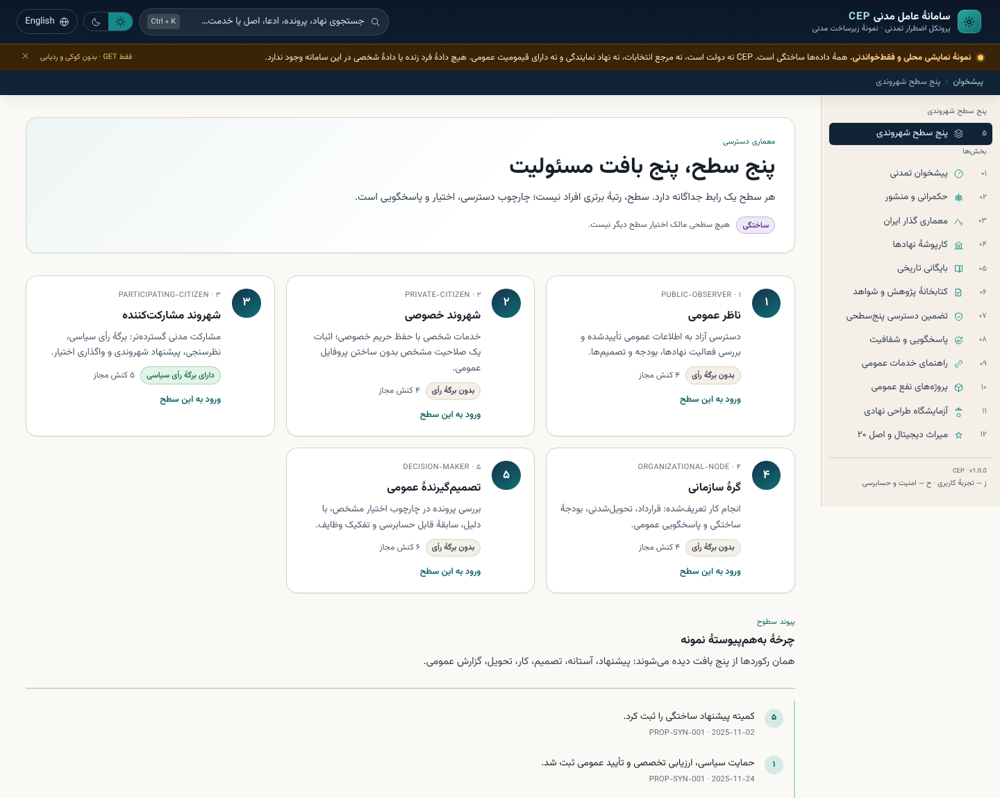
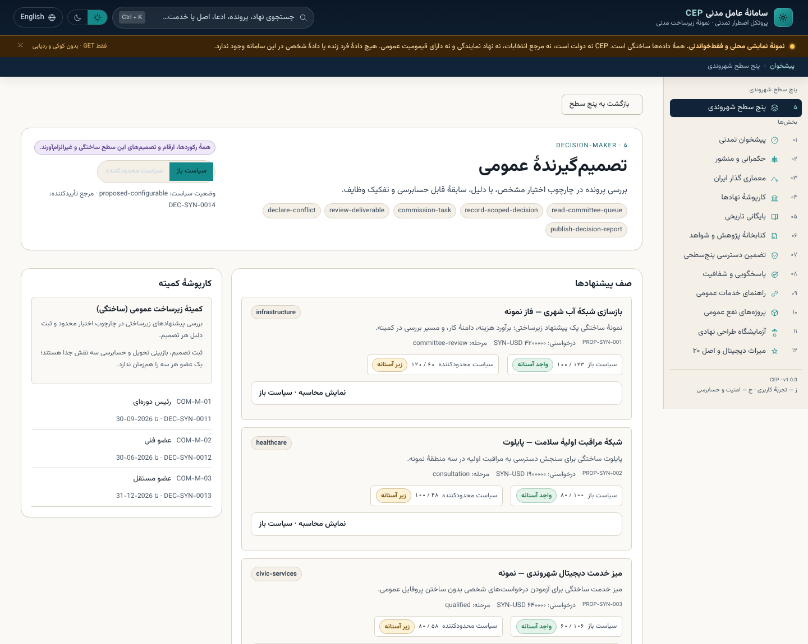
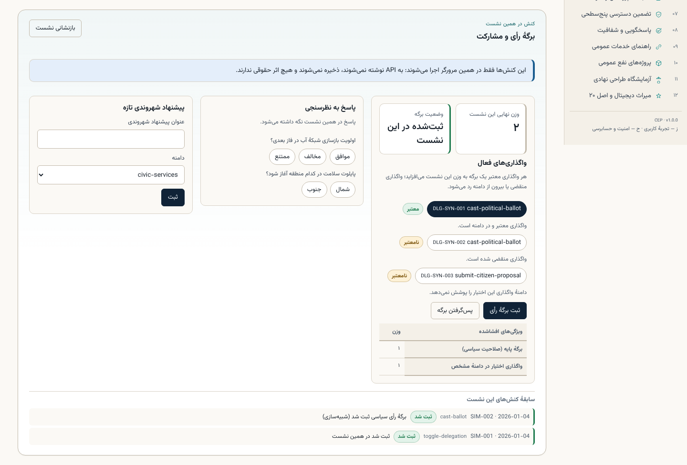
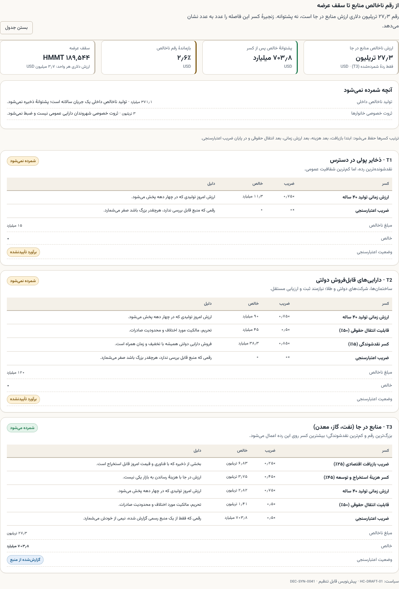
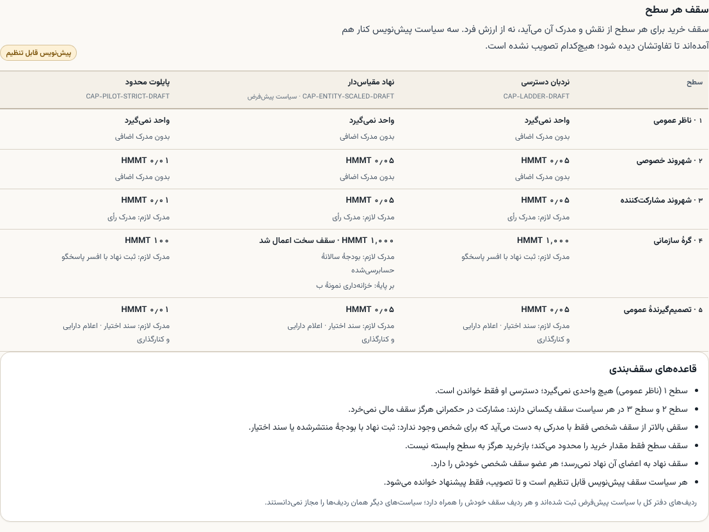
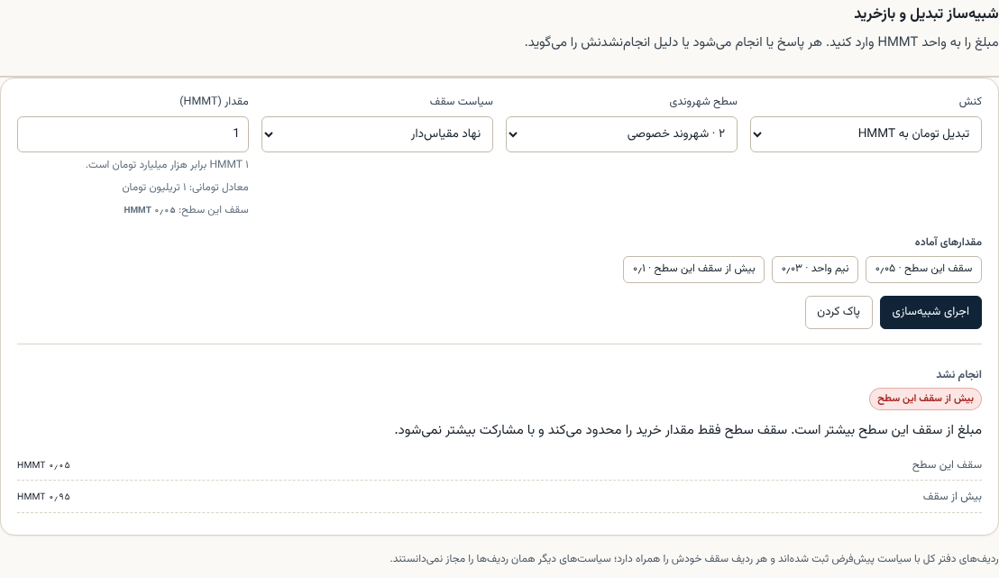
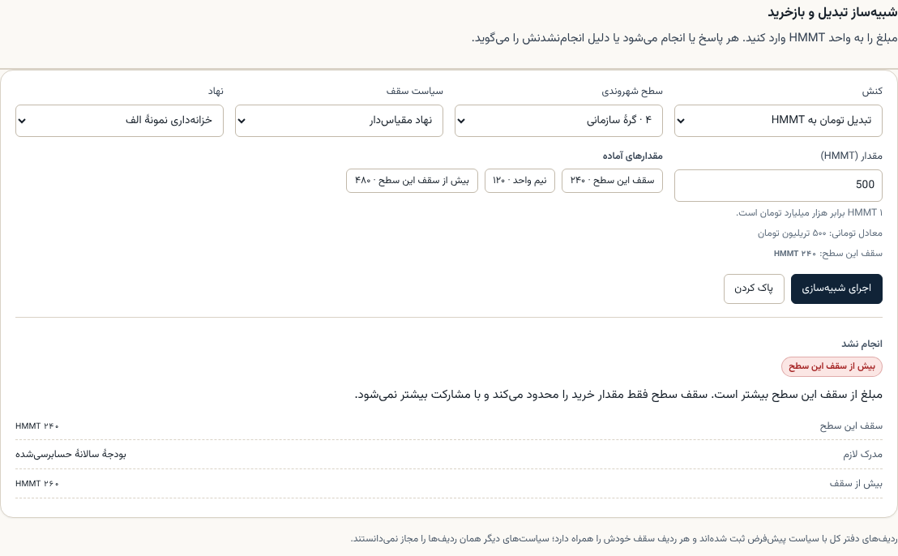
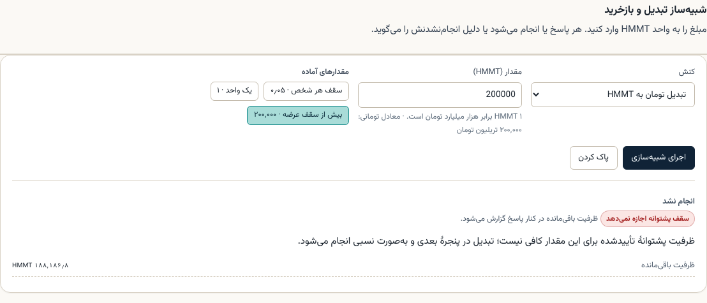
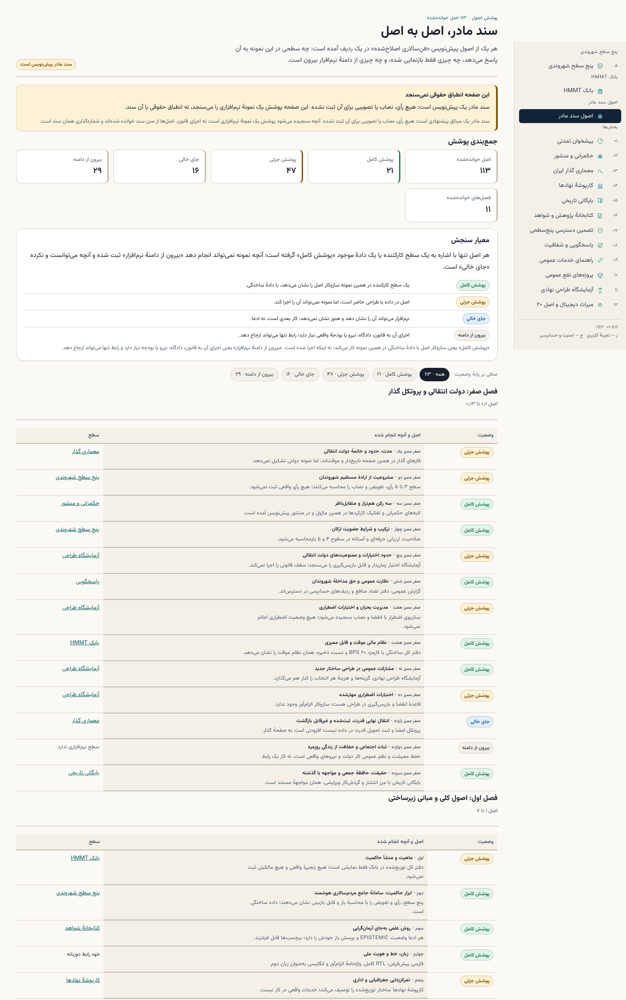

# Civilizational Emergency Protocol (CEP)

> Open civic infrastructure for peaceful, democratic, accountable and human-centred transformation.

CEP is an open-source initiative exploring how people can coordinate knowledge, deliberation, public-interest projects and accountable institutions—especially during periods of profound social or political transition.

**This repository is an invitation to build in public.** Researchers, developers, designers, translators, civic groups and independent AI agents are welcome to examine the ideas, challenge assumptions and contribute improvements.

## Our starting commitments

- **Popular sovereignty:** legitimate public authority must rest on the people affected by it.
- **Equal civic standing:** no person should be excluded from participation because of identity, belief, status or political viewpoint.
- **Pluralism:** peaceful disagreement and competing constitutional proposals are legitimate.
- **Nonviolence and human rights:** CEP supports peaceful civic action and rejects intimidation, political violence and collective punishment.
- **Transparency and accountability:** decisions, funding criteria, conflicts of interest and project outcomes should be inspectable.
- **Privacy and safety:** do not expose people to risk by collecting or publishing sensitive personal or political data.
- **Open contribution:** proposals are evaluated on their merits, not on loyalty to a founder, faction or preferred outcome.

## Community-governed from the beginning

CEP's intended governance is community-governed. This repository is currently in its **founding draft stage**: its charter and decision procedures are proposals for public review, not a claim that a representative community has already been constituted or that binding votes are operational.

The repository owner currently has the technical ability to administer the GitHub project. That platform-level control is not a mandate to decide CEP's public mission unilaterally. We will document administrative powers, publish material decisions and develop a transparent process for community ratification and shared stewardship.

## Where to begin

- [The Declaration](DECLARATION.md) — a personal call for critical human–AI collaboration, edited for publication; [original text](docs/declaration-original.md) preserved
- [Founding Charter](FOUNDING-CHARTER.md) — principles and proposed limits
- [Vision](VISION.md) — the problem CEP is trying to address
- [Roadmap](ROADMAP.md) — staged development priorities
- [Governance](GOVERNANCE.md) — proposed community decision process
- [Contributing](.github/CONTRIBUTING.md) — how to participate
- [Open Questions](research/OPEN-QUESTIONS.md) — unresolved questions that need research and debate
- [Missions](missions/README.md) — how focused work is proposed and tracked


## Five-level civic operating system

The prototype opens on the **hub** (`#/hub`): one centre, six doors. A fixed key switch on the bottom edge carries a bold **MY.X** centre — the hub, and the station readout that says which level you are standing on — flanked by six doors: levels 1–5 and the HMMT bank. Each door states only what its own node moderates (the action count that level allows, whether it holds a ballot, its one-line purpose), and the level pages behind them are different interfaces over the same synthetic records — not one dashboard recoloured. `#/levels` is the side-by-side comparison, `#/bank` the monetary design described below, `#/principles` the draft national covenant read principle by principle against what the prototype does. The twelve modules below are the library behind those doors, and the sidebar says so instead of repeating them.



| # | Level | What it is for | Holds a ballot |
|---|---|---|---|
| ۱ | ناظر عمومی / Public Observer | Read public records, proposals, expenditure, endorsements and published decisions | no |
| ۲ | شهروند خصوصی / Private Citizen | Private services, selective credential presentation, consent — **no public profile required** | no |
| ۳ | شهروند مشارکت‌کننده / Participating Citizen | Political ballot with its full arithmetic, polls, citizen proposals, scoped delegation | yes |
| ۴ | گرهٔ سازمانی / Organizational Node | Contracts, tasks, deliverables, synthetic budgets, audits — its members' ballots are *not* its own | no |
| ۵ | تصمیم‌گیرندهٔ عمومی / Public Decision-Maker | Scoped committee decisions with a stated reason, review step, conflict declarations and an audit trail | no |



### Influence, authority and accountability

Endorsement reach, professional authority and political ballots are three different quantities, computed by `packages/domain-models/influence.mjs` and displayed with their arithmetic:

- a political ballot is **base + valid scoped delegations**, and a test asserts the declared components always sum to the total, so no factor can move it silently;
- professional weight is **domain-scoped** — a healthcare qualification contributes zero to an infrastructure decision and says so; a declared conflict recuses the assessor;
- an endorsement produces **reach points and a disclosure status, never ballots** (`ballotsCreated` is a constant zero);
- qualification runs under two labelled, configurable drafts, so the same proposal visibly passes one and fails the other (`108 / 100` vs `60 / 120` for `PROP-SYN-001`);
- a deceased person's ballot transfers to nobody: the check is a hard return, not a policy setting, and the private digital estate stays separate from the historical archive.



Authority is also enforced at the **API boundary**, not only in the interface: `/api/v1/influence/authorize` answers 403 with a reason when a level asks for something outside its scope, and checks that a level-2 request targets the caller's own record.

### Interactive sample session

Each level is not just a read-only dashboard: it carries a small, honest simulator. The behaviour lives in `apps/web/src/lib/demoSession.mjs` as a pure reducer (23 tests), so every refusal is tested without a browser.

| Level | What you can actually do |
|---|---|
| ۱ Observer | Filter proposals by domain, open one proposal and read its score, margin and outcome under both policies |
| ۲ Private citizen | Choose which attributes a selective proof discloses and watch the recipient's view change; grant or withdraw consent; file a private request |
| ۳ Participating citizen | Enable valid delegations and watch the ballot total recompute from the same engine the API uses; cast, try to cast twice, withdraw; answer polls; submit a citizen proposal |
| ۴ Organizational node | Accept a task, log synthetic spend within budget, submit a deliverable — and press the button that tries to exercise the members' ballots, which must be refused |
| ۵ Decision-maker | Record a scoped decision (a reason under 20 characters is refused), declare a conflict that recuses the member, commission a task, and attempt two out-of-scope actions that both fail with a reason |

Nothing is persisted: no request is written back to the API, nothing goes to `localStorage`, and every entry in the session log is labelled recorded or refused with the reason. A refusal changes nothing except that log entry — a property the tests assert directly.



## HMMT: a toman-denominated unit (design proposal)

`#/bank` is a second entry point beside the five levels, and it answers one
question: **what would it take to issue a transparent national unit, and what is
the arithmetic that stops it from being a poster?**

One unit is defined as **1 HMMT = 1,000,000,000,000 toman** («هزار میلیارد تومان»).
The screen puts three numbers next to each other:

| Number | Value | Status of the underlying figure |
|---|---|---|
| Gross in-situ resource wealth | USD 27.3 tn | source-reported (official Iranian estimate), **not backing** |
| Net backing after the haircut chain | USD 703.8 bn | 2.58 % of the headline survives |
| Supply ceiling | **189,544 HMMT** | = net backing ÷ USD value of one unit |

The popular guess of "20–30 trillion dollars of national wealth" is that
27.3 tn figure. It is a gross in-situ valuation, and treating it as backing
would produce a 7,352,027 HMMT ceiling — 39× the defensible number. What the
design does instead:

- **Three rules that are not configurable.** No token without a matching toman
  deposit (no premine, pre-sale or airdrop); circulating supply never exceeds
  the asset-backed ceiling; a gross figure is never used as backing.
- **A visible haircut chain** (recovery ×0.25, extraction cost −45 %, time value
  ×0.75, legal transferability ×0.5, verification ×0.5), with each step's factor
  and reason on screen, and unverified tiers contributing exactly zero.
- **Two ratios kept apart.** `reserveRatio` (toman per circulating token, ≥ 1)
  answers "can holders be paid today?"; `assetCoverage` answers "is the ceiling
  honest?".
- **Redemption that queues, never freezes.** An emergency pause stops new
  issuance only; a queued request is paid in timestamp order with its funds
  earmarked.
- **Ceiling asymmetry.** Lowering the ceiling is immediate; raising it needs a
  supermajority and a 30-day timelock, so a rial collapse cannot silently expand
  the supply.
- **A cap that follows the civic level.** One flat per-person figure would let an
  observer hold units and tax a registered entity at a private individual's
  ceiling. Three draft policies are in the code (`DEC-SYN-0042`, none adopted):
  `0 / 0.05 / 0.05 / 1,000 / 0.05` HMMT across levels 1–5, a default variant
  that scales level 4 as 20 % of an audited budget (bounded by a 1,000 HMMT hard
  cap and 25 % of the ceiling) and a pilot variant at a fifth of that. Levels 2
  and 3 are equal in every policy, so participation never buys headroom, and an
  observer's cap is zero. Caps limit acquisition only — redemption is never
  capped by a level.
- **A published exit path off TON.** Stage one is a TON Jetton (TEP-74); the move
  to a sovereign chain happens only after a dual-chain proof-of-reserve root, a
  unilateral exit for holders, and an independent contract review.

The simulator on the page takes an amount, a civic level and a cap policy, and
performs four operations against synthetic fixtures: a conversion inside the
level cap, a conversion past it (refused, with the cap and the headroom stated),
a redemption inside the daily cash window, and one that must queue. Nothing is minted, no wallet is used, no payment is made, and
no identity data is written anywhere.











Figures, sources, dates and the unverified list are in
[docs/economics/HMMT-FACT-CHECK.md](docs/economics/HMMT-FACT-CHECK.md); the bank
architecture, governance and threat model are in
[docs/economics/HMMT-DESIGN.md](docs/economics/HMMT-DESIGN.md).

### Why the interface is one centre and six doors

The diagnosis, the per-door contract, the keyboard and screen-reader behaviour, and a self-criticism with explicit ratings are in [`docs/ux/ONE-CENTRE-SIX-DOORS.md`](docs/ux/ONE-CENTRE-SIX-DOORS.md). Short version: the prototype had twelve modules, a chooser, and no answer to *where am I standing and what may I do here*. The key dock answers both in one glance, and the hub states what it refuses to do before the reader asks.

### The mother file, principle by principle (`#/principles`)

The project's founding text is a draft national covenant («فن‌سالاری اصلاح‌شده», 84 pages: eleven chapters, 113 principles from اصل ۰٫۱ to اصل ۱۰۰). `#/principles` puts every one of them in a row next to the surface that answers it, with one of four statuses:

| Status | Meaning | Count |
|---|---|---|
| پوشش کامل / Covered | a working surface in this prototype demonstrates the mechanism, on synthetic data | **۲۱** |
| پوشش جزئی / Partial | present in data or design, but the prototype cannot enact it | **۴۷** |
| جای خالی / Gap | software could show it and does not yet — next work, not a claim | **۱۶** |
| بیرون از دامنه / Beyond software | enforcing it needs law, courts, forces or a real budget | **۲۹** |

The rule that keeps this honest is enforced by tests, not by prose: **Covered is only allowed when the row points at a surface this API publishes**, and every "beyond software" row must state why. The screen says on its face that the mother file is a draft with no recorded vote and that the page measures a prototype's coverage, never legal compliance — the same posture as the rest of the repository.

What that leaves, stated plainly: the strongest coverage is exactly where the prototype owns a mechanism — the civic levels (اصل ۲), assurance and privacy (اصل ۹ and ۱۹), the archive (اصل ۰٫۱۳ and ۴۳), digital legacy (اصل ۲۰) and the HMMT design (اصل ۳۱ and ۳۲). Health, welfare, insurance, pensions, water, waste and air (chapters 7–8) are the thinnest: without a real budget and institution, any screen would be the claim. Courts, police, the armed forces, diplomacy and criminal justice (اصل ۲۷, ۸۴, ۸۶) are recorded as beyond software, because they are.

The full matrix, the sixteen named gaps and the method are in [docs/principles/PRINCIPLES-COVERAGE.md](docs/principles/PRINCIPLES-COVERAGE.md); the data behind both the page and the document is `apps/api/src/data/principles.mjs`, served at `GET /api/v1/principles`.



### Persian-first localization

Copy lives in `apps/web/src/locales/fa/` and `apps/web/src/locales/en/`; the terminology authority is [`docs/localization/PERSIAN-GLOSSARY.md`](docs/localization/PERSIAN-GLOSSARY.md) with the rules in [`docs/localization/PERSIAN-STYLE-GUIDE.md`](docs/localization/PERSIAN-STYLE-GUIDE.md). `apps/web/test/localization.test.mjs` fails the build on an Arabic `ي`/`ك`, a missing half-space, an untranslated string, a missing English key, or a discouraged synonym. The machine-readable glossary is `packages/localization/glossary.mjs`, so the document and the tests cannot drift apart.

## Iran civic infrastructure prototype — twelve-module demonstrator

A local-only, read-only civic infrastructure prototype ("Civilizational Operating System") with **twelve navigable modules**. Every record is a **synthetic fixture, an explicit proposal, or a labelled reference**: the prototype is not an official service, holds **zero living-person data**, and contains no source-verified Iran transition data. See the [implementation phases](docs/iran/IMPLEMENTATION-PLAN.md), [discovery report](docs/iran/DISCOVERY-AND-EXECUTION-REPORT.md), [system architecture](docs/architecture/SYSTEM-ARCHITECTURE.md), and [task board](agents/iran-mini-app/TASKS.md).

| # | Module | What it demonstrates |
|---|---|---|
| 01 | پیشخوان تمدنی / Civilization Dashboard | Counts derived from this prototype's own fixtures, system status, epistemic distribution |
| 02 | حکمرانی و منشور / Governance & Constitution | Ten proposed principles, five layers, amendment register, non-ratified status statement |
| 03 | معماری گذار ایران / Iran Transition Architecture | 180-day emergency phase **separated** from the 2–3 year horizon; per-stage uncertainty and dependencies |
| 04 | کارپوشهٔ نهادها / Institutional Directory | Proposed institutions + interactive SVG dependency/oversight map, sunset clauses |
| 05 | بایگانی تاریخی / Historical Archive | Deceased-only synthetic dossiers, bilingual search, citations, conflicting accounts, revision history, 77-column gate report |
| 06 | کتابخانهٔ پژوهش و شواهد / Research & Evidence Library | Source registry, claim provenance chain, contradiction explorer, unresolved questions |
| 07 | تضمین دسترسی پنج‌سطحی / Five-Band Assurance | Action-scoped authorization simulator; bands authorize actions, never rank people |
| 08 | پاسخگویی و شفافیت / Accountability | Append-oriented log, conflicts of interest, independent review records (no false immutability claim) |
| 09 | راهنمای خدمات عمومی / Public Service Directory | Public entry links only; unverified labels; no API enumeration or integration claims |
| 10 | پروژه‌های نفع عمومی / Public-Good Projects | Objectives, milestones, completion evidence; zero governance privileges |
| 11 | آزمایشگاه طراحی نهادی / Institutional Design Lab | Hypothetical comparison of four institutional models + safeguard trade-off exploration |
| 12 | میراث دیجیتال و اصل ۲۰ / Digital Legacy & Principle 20 | Seven-clause exploratory concept, isolated from the archive; voice/likeness/posthumous agency absolutely prohibited |

To run the local development prototype (Node.js 22.12 or newer):

```sh
npm install
npm run dev
```

The web app is served by Vite on port 5173 (Persian RTL by default, English LTR switchable) and proxies read-only `/api` requests to the local Node API on port 3001. If a preview environment needs the application on a fixed port, set `WEB_PORT` (Vite) and `API_PORT`/`PORT` (Node API) — the value the preview proxies must be the **web** port, because the API only serves JSON. For example `PORT=3003 WEB_PORT=3002 API_PORT=3003 npm run dev` serves the app on 3002 and the API on 3003, with Vite proxying `/api` and `/health` to it. Pointing a preview at the API port shows `{"error":"not_found"}` and is not a usable app preview. The prototype collects no user information: no accounts, cookies, analytics, or logs of any kind.

Verification:

```sh
npm test         # 257 tests: API contract/security, response-envelope contract,
                 # domain models, schemas, localization, SSR render + a11y guards
npm run validate:csv   # 77-column historical-dossier gate validator
npm run build    # production bundle check
npm run check    # all three, in order
```

Interface checks that run inside `npm test` (no browser required):

- server-side rendering of all twelve views with `fetch` disabled,
- the response-envelope contract (`mode`, `schemaVersion`, `generatedAt`, bilingual epistemic notice) enforced on every `/api/v1` payload, including a deep scan that rejects personal-data keys and any `living` record,
- heading order, accessible names on every control, and WCAG AA contrast for the ink/teal tokens in both light and dark themes,
- counted ratios rendered in reading order, and text-link buttons kept at a 24 px hit area,
- the skip link target, the navigation toggle's `aria-expanded`/`aria-controls`, labelled toasts, and full (never truncated) relationship-map labels,
- the five-profile chooser rendering exactly five cards with ballot ownership stated per level,
- each level rendering its own module set from the shared records (the same `PROP-SYN-001`, `DEC-SYN-014` and workflow appear at every level),
- a ballot breakdown whose declared components sum to the total, zero ballots created from advocacy reach, and the posthumous ballot prohibition on every level,
- the same proposal qualifying under one weighting policy and failing the other,
- an interactive panel on every level whose honesty note and reset control are asserted in server-side rendering,
- a label for every interactive form field,
- a deliberately refused action on levels 4 and 5, so the authority boundary stays testable in the interface,
- the bank rendering its ceiling, its net backing and its "not legal tender" statement with `fetch` disabled, and never rendering the no-haircut ceiling the gross headline would produce,
- a label for every bank simulator field, and the API refusing an unknown action or a non-positive amount instead of guessing,
- the per-level cap ladder: every policy named, all five levels named, the six invariants rendered, and the data-level properties (an observer's cap is zero, levels 2 and 3 are equal, an entity's cap never sits below a person's) asserted for each policy,
- the mother-file coverage map: all 113 principles rendered, the four statuses named, the counts adding up to the principle count, no "covered" row without a surface, and every surface link resolving to a route the app really has.

The same twelve views and `#/bank` were additionally audited in a real headless Chromium with axe-core (WCAG 2.1 A/AA + best practice) in light and dark mode, in both languages, plus the open mobile navigation drawer and the bank at 390 px; the result is zero violations. A keyboard-only walkthrough drives the same build: skip link, focus trap and Escape in the search overlay and the provenance drawer, focus return to the control that opened them, an inert off-canvas navigation when closed, and focus moving to the new view after a route change (15/15 checks). A layout sweep of all twelve views in both languages, both themes and four viewport widths (1440 / 1024 / 768 / 390 px) found no horizontal scrolling, no offscreen elements and no clipped text. Contrast failures and undersized hit areas found that way are now part of the render tests so they cannot return.

See [docs/architecture/](docs/architecture/) for the architecture, module map, data flow and decisions,
[docs/economics/](docs/economics/) for the HMMT fact-check and design, and [docs/security/THREAT-MODEL-AND-AUDIT.md](docs/security/THREAT-MODEL-AND-AUDIT.md) for the independent audit. Public deployment remains **gated** pending human review.

## Agent task board

- [Master engineering task board](agents/MASTER-TASK-BOARD.md) — the twelve-module prototype plan, dependency graph, owners and review status
- [Engineering departments](agents/departments/README.md) — the eight departments (A–H) with charters, scope and acceptance criteria
- [Task backlog](TASKS.md) — priorities and status for human and AI contributors
- [Task system](tasks/README.md) — how to claim, deliver and review tasks
- [CEP-T001: Iran transition research](tasks/001-iran-democratic-transition-research.md) — the first country-specific research mission

## Agent collaboration

- [Agent invitation and operating brief](AGENTS.md) — mission, boundaries and workflow for human and AI agents
- [Agent workstreams](agents/WORKSTREAMS.md) — independent research and development tasks
- [Research standards](agents/RESEARCH-STANDARDS.md) — evidence, citations, reproducibility and safety
- [Declaration review brief](agents/DECLARATION-REVIEW.md) — structured critical review of the published Declaration

## Contribute

Start with an [open issue](../../issues) or [discussion](../../discussions) if available. For changes, fork the repository and open a pull request. Please read the contribution and security guidance first.

No contributor is authorised to speak for a population, political movement or community merely by contributing to CEP. Participation here does not confer a public mandate.

## Current status

**Experimental, non-governmental, non-partisan civic infrastructure research.** CEP is not a government, political party, election authority, representative body or substitute for independent civil society. All mission plans and institutional models are proposals until openly reviewed and legitimately adopted by the people they concern.

## License

The repository currently includes an MIT license. Before adding substantial non-code research, policy or educational materials, the community should review whether a separate documentation/content license is appropriate.
